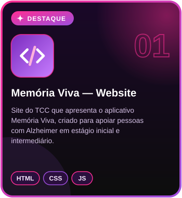
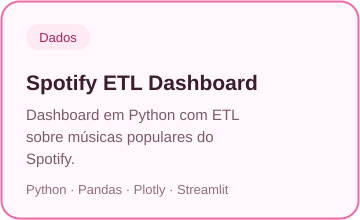
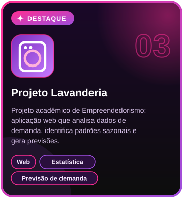
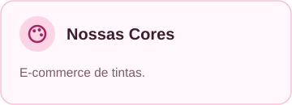
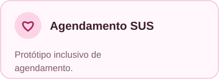
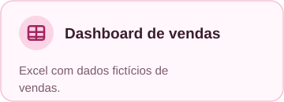
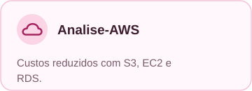

# Manuella Santos — Web Developer

Desenvolvedora web e estudante de Ciência de Dados, formada em Informática para a Internet pela ETEC Albert Einstein.
Apaixonada por tecnologia, design, biotecnologia e por projetos que fazem a diferença.

Amo rosa, animais e sorvete 🌸🐾🍦

## Tech Stack

### **Languages**

### **Tools**

## **Projetos Principais**

<table>
  <tr>
    <td align="center" valign="top">
       
       
    </td>
    <td align="center" valign="top">
       
       
    </td>
    <td align="center" valign="top">
       
      
    </td>
  </tr>
</table>

<table>
  <tr>
    <td align="center" valign="top">
       
       
    </td>
    <td align="center" valign="top">
       
       
    </td>
    <td align="center" valign="top">
       
       
    </td>
  </tr>
  <tr>
    <td align="center" valign="top">
       
      
    </td>
    <td align="center" valign="top">
       
      
    </td>
  </tr>
</table>

## GitHub Stats

## Atualmente Estudando

##  Redes Sociais

Obrigada por visitar meu perfil! ✨🌸

