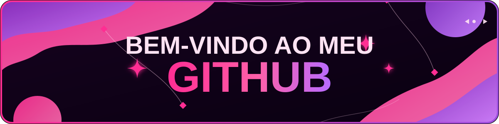
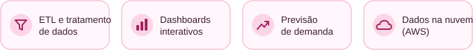

# Manuella Santos

Desenvolvedora web e estudante de Ciência de Dados, formada em Informática para a Internet pela ETEC Albert Einstein. 
Apaixonada por tecnologia, design, biotecnologia e por projetos que fazem a diferença.

Amo rosa, animais e sorvete 🌸🐾🍦

## O que eu faço com dados

### Skills

**Ciência de dados**

**Outras**

## Projetos em destaque

<table>
  <tr>
    <td align="center" valign="top" width="33%">
      
      <h3><a href="https://github.com/Manuellasantos/spotify-etl-dashboard">Spotify ETL Dashboard</a></h3>
      Pipeline de ETL e dashboard interativo com dados do Spotify.  
      
      
      
        
      
      
    </td>
    <td align="center" valign="top" width="33%">
      
      <h3><a href="https://github.com/Cosmic-Bubble/projetolavanderia">Projeto Lavanderia</a></h3>
      Sistema de previsão de demanda para uma iniciativa comunitária de lavanderia, aplicando matemática, estatística e programação.  
        
      
      
    </td>
    <td align="center" valign="top" width="33%">
      
      <h3><a href="https://github.com/Manuellasantos/website-memoria-viva">Memória Viva</a></h3>
      Website Memória Viva.  
      
      
        
      
      
      
    </td>
  </tr>
</table>

### Mais projetos

<table>
  <tr>
    <td valign="top" width="33%">
      <b><a href="https://github.com/Manuellasantos/Analise-AWS">Analise-AWS</a></b> 
      Trilha TOTVS: análise de dados com serviços da AWS.  
      
      
        
      
    </td>
    <td valign="top" width="33%">
      <b><a href="https://github.com/Manuellasantos/dashboard-vendas-excel">Dashboard de vendas</a></b> 
      Prática de Excel: dashboard de vendas.  
        
      
    </td>
    <td valign="top" width="33%">
      <b><a href="https://github.com/Manuellasantos/Black-In-Tech">App BiT</a></b> 
      MVP B2B do Hackathon Wongola 2026.  
      
      
      
        
      
      
      
    </td>
  </tr>
  <tr>
    <td valign="top" width="33%">
      <b><a href="https://github.com/Manuellasantos/Agendamento-sus">Agendamento SUS</a></b> 
      Website de agendamento do SUS.  
      
      
        
      
      
    </td>
    <td valign="top" width="33%">
      <b><a href="https://github.com/nanda-marques/nossasCores">Nossas Cores</a></b> 
      E-commerce.  
      
      
        
      
      
    </td>
  </tr>
</table>

<h3>𝓞𝓫𝓻𝓲𝓰𝓪𝓭𝓪 𝓹𝓸𝓻 𝓿𝓲𝓼𝓲𝓽𝓪𝓻 𝓶𝓮𝓾 𝓹𝓮𝓻𝓯𝓲𝓵 </h3>

